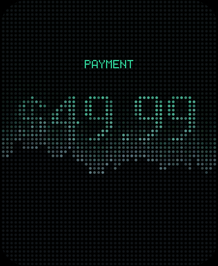

# stripe-dot-display

A little desk object that tells you when you get paid.

A Waveshare 1.8" AMOLED (368×448) on an ESP32-S3 renders the headline numbers
as a grid of dots — the same technique as the `docs-graph` hero: a uniform
lattice where each dot's brightness is a base level plus a slow pulse, a
spatial wave, a twinkle and a rare sparkle.

It is tuned to read as a physical LED sign rather than a web effect, which
comes down to three rules:

- **Every dot is the same size.** The web original scales radius with
  brightness; on a panel that makes unlit dots visibly smaller and the
  lattice stops reading as one fixed grid of LEDs.
- **Unlit dots stay faintly lit** (`AMBIENT_LEVEL`), so the grid is always
  there and content lights up *within* it.
- **Transitions wipe, they don't cross-fade.** Each dot goes dark and
  relights with the new frame a beat later, staggered outward from the
  middle, so a card is erased and repainted the way a sign repaints. The
  text layer is masked by the same sweep, so type never pops while the
  lattice is still wiping.
- **The payment banner travels one way and lights what it passes.** Two
  octaves of value noise give its edge a torn, hand-made line; a clean
  geometric ripple reads as a screensaver. Nothing is drawn at the panel
  edge, so the rounded corners are simply empty rather than clipping a frame.

Small type is deliberately **not** dotted — quantising a 14px label to a 7px
lattice loses most of its strokes and buys nothing. Labels and captions are
drawn as crisp pixel glyphs composited over the dots, which is also why a
full email address fits where a dot-rendered one had to be truncated.

When a Stripe payment lands, a thin ragged banner crosses the panel once and
leaves the amount lit in its wake. The rest of the time it cycles your stats.
Tap the glass to fire one on demand -- useful for filming it, and for checking
the thing works before any webhook exists.

| | | |
|---|---|---|
|  |  |  |
|  |  |  |

## How it fits together

```
Stripe ──webhook──> Cloudflare Worker ──verify sig──> Durable Object
                                                           │
                                                   SSE over TLS
                                                           │
                                                           ▼
                                              ESP32-S3 + 368×448 AMOLED
```

The device holds **no Stripe credentials**. It authenticates to the Worker with
a single device token and receives a tiny JSON shape over one long-lived
Server-Sent-Events connection. The Worker verifies Stripe's signature, computes
the stats, and pushes both payments and periodic stat refreshes down the same
stream. Typical end-to-end latency from Stripe firing to the screen lighting up
is a few hundred milliseconds.

## Hardware

- **Waveshare ESP32-S3-Touch-AMOLED-1.8** — 368×448 AMOLED, CO5300 over QSPI,
  16MB flash / 8MB PSRAM, AXP2101 PMIC, ES8311 codec, QMI8658 IMU.
- USB-C cable. That's it — no wiring.

### Identify your board before you flash

Waveshare sells several visually similar S3 AMOLED boards whose pin maps and
resolutions differ, and whose published wiki tables contradict each other.
**QSPI is write-only**, so a wrong pin map still lets `begin()` return `true`
and simply leaves the screen black — you cannot detect it in software.

Fingerprint the unit instead. `pio run -e i2cscan -t upload` sweeps every safe
GPIO pair for the I²C bus and names what it finds. This board answers:

```
SDA=15 SCL=14 : 0x15 touch  0x18 ES8311  0x20 TCA9554
                0x34 AXP2101 (chip id 0x4A)  0x51 PCF85063  0x6B QMI8658 (0x05)
```

If yours differs, it is a different board — find its `pin_config.h` in
[github.com/waveshareteam](https://github.com/waveshareteam) and put those
numbers in `board.h`. `pio run -e pinfinder -t upload` cycles candidate
configs, one per boot, drawing its number and a border that only closes into a
clean rectangle when the geometry is right.

## Setup

### 1. Deploy the relay

```bash
cd relay
npm install
npx wrangler login
npx wrangler deploy
```

Then set the three secrets:

```bash
npx wrangler secret put STRIPE_SECRET_KEY      # restricted key, see below
npx wrangler secret put STRIPE_WEBHOOK_SECRET  # whsec_... from step 2
npx wrangler secret put DEVICE_TOKEN           # openssl rand -hex 32
```

Create the Stripe key at **Developers → API keys → Create restricted key** with
*read* on: **Charges**, **Balance**, **Payouts**, and **Subscriptions** (only if
you want the MRR card). Nothing needs write access.

### 2. Point Stripe at it

**Developers → Webhooks → Add endpoint**, URL
`https://stripe-dots.<you>.workers.dev/webhook/stripe`, and select:

- `charge.succeeded`
- `charge.refunded`
- `checkout.session.completed`
- `payment_intent.succeeded`

Copy the signing secret into `STRIPE_WEBHOOK_SECRET`. Sending all four is fine —
the Durable Object de-dupes on the charge id, so a payment that emits both a
`payment_intent` and a `charge` only lights the screen once.

### 3. Flash the firmware

**Try demo mode first.** `DEMO_MODE 1` is the default in `config.h`: synthetic
stats and a fake sale every 52 seconds, with no WiFi and no Stripe. It's the
fastest way to confirm the panel, the pin map and the framerate.

```bash
cd firmware
pio run -t upload && pio device monitor
```

When that looks right, put your real credentials in `secrets.h` (gitignored)
and set `DEMO_MODE 0`:

```bash
cp include/secrets.example.h include/secrets.h
$EDITOR include/secrets.h
```

### 4. Check it works

```bash
curl -X POST "https://stripe-dots.<you>.workers.dev/v1/test?cents=4999&who=you@example.com" \
     -H "Authorization: Bearer $DEVICE_TOKEN"
```

The screen should flash, fire a ring, and land on **$49.99**. There's also
`GET /v1/snapshot` if you want to see the stats JSON the device is working from.

## Customising it

Everything you'd want to change is in **`firmware/include/config.h`**.

```c
#define IDLE_CARDS   CARD_TODAY,      \
                     CARD_SPARKLINE,  \
                     CARD_BALANCE,    \
                     CARD_PAYOUT,     \
                     CARD_CLOCK
```

Delete lines, reorder them, duplicate them — the pager dots at the bottom follow
automatically. `CARD_MRR` is available too, but you need `ENABLE_MRR = "1"` in
`wrangler.jsonc` for it to have data.

The same file holds the dot pitch, radius, palette, shimmer constants, dwell
times and the alert hold. `DOT_SPACING` is the big visual lever: 6 is fine and
dense, 8 is the default, 12 is chunky and brutalist.

To add a card: add an enum in `cards.h`, a `case` in `drawCard()`, and the
field it reads to `Snapshot` in `relay/src/stripe.ts`.

## The simulator

Layout on a round panel is easy to get wrong, so the rendering code builds and
runs on the host — same `dotgrid.cpp`, `cards.cpp` and `fonts.cpp` the firmware
uses, just a stub framebuffer instead of a QSPI panel.

```bash
bash tools/sim/build.sh
./tools/sim/sim /tmp/out && python3 tools/sim/png.py /tmp/out
```

It renders every screen to PNG and fails the run if any glyph lands where the
circle has no dot — which is what a too-long label looks like before you've
flashed anything. Nothing in `docs/screens/` was shot on hardware; they're all
from this. It renders the same code the firmware runs, so a layout change can
be reviewed before it is flashed.

## Layout notes

The panel is a 368×448 rectangle; the dot lattice is 52×64 cells at the
default 7px pitch. Two layers compose each frame — dots for the headline
numerals, bars and frame, crisp pixel text for everything smaller:

| tier | font | advance | fits at mid-height |
|---|---|---|---|
| label | 5×7 solid, 2× | pixels | ~30 chars |
| headline | 7×11 dots | per-glyph | 6 wide glyphs |
| value | 5×7 solid, 3× | pixels | ~20 chars |

Money is formatted to fit rather than truncated: under $100 keeps the cents
(`$49.99`), under $100k drops them (`$12,849`), above that it goes compact
(`$123.4k`, `$12.3M`).

## Troubleshooting

**Black screen.** Almost certainly the wrong board. Run the I²C scan above —
it identifies the unit in about a minute, which is far faster than permuting
pin maps (ask me how I know). `begin()` returning `true` means nothing here.

**Picture is torn or sheared.** The width is wrong, not the pins. A wrong
`LCD_W` makes every row start at the wrong byte offset. Check `LCD_W`/`LCD_H`
and `LCD_COL_OFF1` against your board's `pin_config.h`.

**Screen says OFFLINE.** WiFi. The ESP32-S3 is 2.4GHz only.

**Screen shows cards but STALE.** The stream is up but stats aren't arriving —
check `npx wrangler tail` for Stripe API errors, usually a restricted key
missing a read scope.

**Payments never appear.** Check the webhook's delivery log in the Stripe
dashboard. A 400 there means `STRIPE_WEBHOOK_SECRET` doesn't match the endpoint.

## Performance

27fps on the 368×448 panel, which is where the 30fps cap and the SPI bus meet.
Getting there took three fixes worth knowing about if you touch the renderer —
the first build managed 7.4fps:

| stage | before | after | what changed |
|---|---|---|---|
| update | 13.1ms | 4.1ms | per-dot `sinf` replaced by angle addition: `sin(t·k+p)` expands to `sin(t·k)cos(p) + cos(t·k)sin(p)`, and `cos(p)`/`sin(p)` are fixed per dot. Three `sinf` calls per *frame* instead of three per dot. |
| draw | 65.3ms | 17.3ms | per-pixel `sqrtf` replaced by 32 precomputed 7×7 coverage sprites; transparent pixels skipped. |
| push | 45.9ms | 12.6ms | the big one. `draw16bitRGBBitmap()` byte-swaps every pixel into a staging buffer — 29ms/frame, more than the SPI transfer itself. Writing bands big-endian up front and pushing them with `writeBytes()` makes it a straight DMA. |

The remaining 12.6ms is close to the theoretical floor for 434KB at 80MHz QSPI
(10.9ms), so further gains have to come from pushing fewer pixels.

Two things that sound like they'd help and don't: a bigger
`ESP32QSPI_MAX_PIXELS_AT_ONCE` (46→43ms; transaction count was never the
problem) and moving the framebuffer out of PSRAM into internal-SRAM bands
(no change on its own — the swap loop was slow regardless of where it read
from). Both conclusions came from measuring, and the band structure stayed
because it's what makes the DMA push possible.

Set `PROFILE_FRAME 1` in `config.h` to get the per-stage numbers over serial.

## Cost

Comfortably inside Cloudflare's free tier: one Durable Object holding one SSE
connection, a heartbeat every 20s and a stats rebuild every 60s. The free plan
allows 100k requests and 13,000 GB-s of duration per day.
