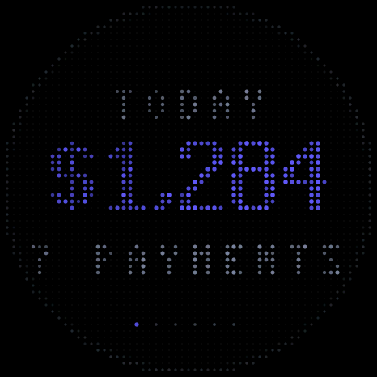
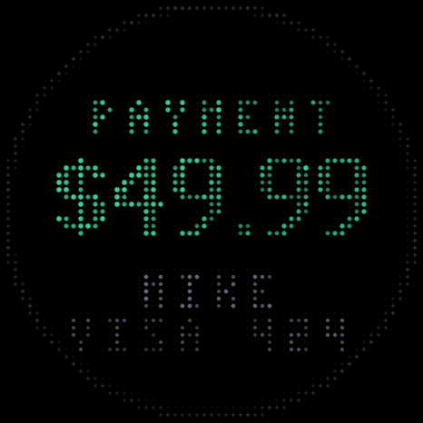
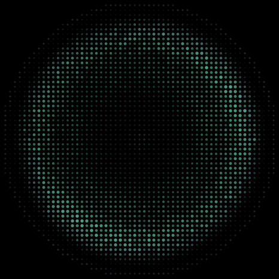
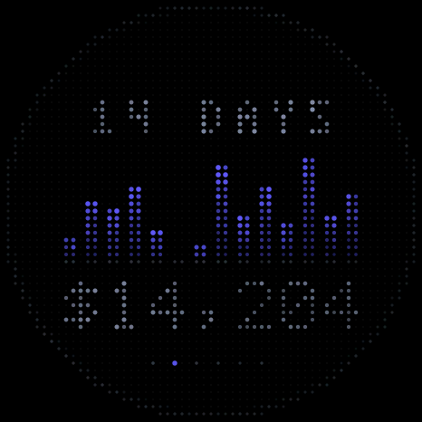
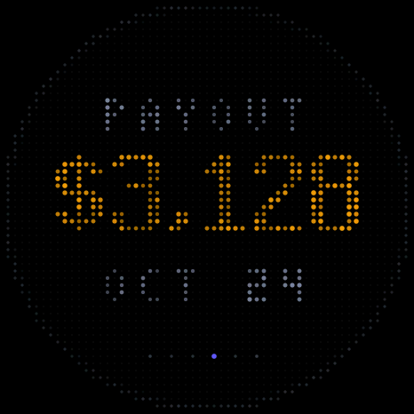

# stripe-dot-display

A little desk object that tells you when you get paid.

A Waveshare 1.43" round AMOLED on an ESP32-S3 renders everything as a grid of
dots — the same technique as the `docs-graph` hero: a uniform lattice where
each dot's brightness is a base level plus a slow pulse, a spatial wave, a
twinkle and a rare sparkle, and where the dot's *radius* tracks its brightness.
Content is a mask over that lattice, revealed with a staggered radial wipe.

When a Stripe payment lands, a shockwave fires out from the centre and the
amount materialises behind it. The rest of the time it cycles your stats.

| | | |
|---|---|---|
|  |  |  |
|  |  |  |

## How it fits together

```
Stripe ──webhook──> Cloudflare Worker ──verify sig──> Durable Object
                                                           │
                                                   SSE over TLS
                                                           │
                                                           ▼
                                              ESP32-S3 + 466×466 AMOLED
```

The device holds **no Stripe credentials**. It authenticates to the Worker with
a single device token and receives a tiny JSON shape over one long-lived
Server-Sent-Events connection. The Worker verifies Stripe's signature, computes
the stats, and pushes both payments and periodic stat refreshes down the same
stream. Typical end-to-end latency from Stripe firing to the screen lighting up
is a few hundred milliseconds.

## Hardware

- **Waveshare ESP32-S3-Touch-AMOLED-1.43** — 466×466 round AMOLED, SH8601/CO5300
  over QSPI, 16MB flash / 8MB PSRAM. The square CNC case + battery version is
  the one this was written for.
- USB-C cable. That's it — no wiring.

## Setup

### 1. Deploy the relay

```bash
cd relay
npm install
npx wrangler login
npx wrangler deploy
```

Then set the three secrets:

```bash
npx wrangler secret put STRIPE_SECRET_KEY      # restricted key, see below
npx wrangler secret put STRIPE_WEBHOOK_SECRET  # whsec_... from step 2
npx wrangler secret put DEVICE_TOKEN           # openssl rand -hex 32
```

Create the Stripe key at **Developers → API keys → Create restricted key** with
*read* on: **Charges**, **Balance**, **Payouts**, and **Subscriptions** (only if
you want the MRR card). Nothing needs write access.

### 2. Point Stripe at it

**Developers → Webhooks → Add endpoint**, URL
`https://stripe-dots.<you>.workers.dev/webhook/stripe`, and select:

- `charge.succeeded`
- `charge.refunded`
- `checkout.session.completed`
- `payment_intent.succeeded`

Copy the signing secret into `STRIPE_WEBHOOK_SECRET`. Sending all four is fine —
the Durable Object de-dupes on the charge id, so a payment that emits both a
`payment_intent` and a `charge` only lights the screen once.

### 3. Flash the firmware

Edit `firmware/include/config.h` — WiFi, your `workers.dev` host, the device
token — then:

```bash
cd firmware
pio run -t upload && pio device monitor
```

### 4. Check it works

```bash
curl -X POST "https://stripe-dots.<you>.workers.dev/v1/test?cents=4999&who=you@example.com" \
     -H "Authorization: Bearer $DEVICE_TOKEN"
```

The screen should flash, fire a ring, and land on **$49.99**. There's also
`GET /v1/snapshot` if you want to see the stats JSON the device is working from.

## Customising it

Everything you'd want to change is in **`firmware/include/config.h`**.

```c
#define IDLE_CARDS   CARD_TODAY,      \
                     CARD_SPARKLINE,  \
                     CARD_BALANCE,    \
                     CARD_PAYOUT,     \
                     CARD_CLOCK
```

Delete lines, reorder them, duplicate them — the pager dots at the bottom follow
automatically. `CARD_MRR` is available too, but you need `ENABLE_MRR = "1"` in
`wrangler.jsonc` for it to have data.

The same file holds the dot pitch, radius, palette, shimmer constants, dwell
times and the alert hold. `DOT_SPACING` is the big visual lever: 6 is fine and
dense, 8 is the default, 12 is chunky and brutalist.

To add a card: add an enum in `cards.h`, a `case` in `drawCard()`, and the
field it reads to `Snapshot` in `relay/src/stripe.ts`.

## The simulator

Layout on a round panel is easy to get wrong, so the rendering code builds and
runs on the host — same `dotgrid.cpp`, `cards.cpp` and `fonts.cpp` the firmware
uses, just a stub framebuffer instead of a QSPI panel.

```bash
bash tools/sim/build.sh
./tools/sim/sim /tmp/out && python3 tools/sim/png.py /tmp/out
```

It renders every screen to PNG and fails the run if any glyph lands where the
circle has no dot — which is what a too-long label looks like before you've
flashed anything. Nothing in `docs/screens/` was shot on hardware; they're all
from this.

## Layout notes

The panel is **round**, so usable width depends on height. `chordAt()` in
`cards.cpp` computes it, and the type hierarchy is built around the constraint:

| tier | font | advance | fits at mid-height |
|---|---|---|---|
| label | 3×5 micro, caps | 5 cells | ~11 chars |
| headline | 7×11 display | per-glyph | 6 wide glyphs |
| value | 5×7 | 6 cells | ~9 chars |

Money is formatted to fit rather than truncated: under $100 keeps the cents
(`$49.99`), under $100k drops them (`$12,849`), above that it goes compact
(`$123.4k`, `$12.3M`).

## Troubleshooting

**Black screen.** Waveshare shipped this board with two panel controllers and
two pin maps. Flip `PANEL_VARIANT` in `firmware/include/board.h`, and if that
doesn't do it, `PINMAP_VARIANT`. Ground truth is the demo zip for your board
revision — the pin table is at the top of its display driver.

**Screen says OFFLINE.** WiFi. The ESP32-S3 is 2.4GHz only.

**Screen shows cards but STALE.** The stream is up but stats aren't arriving —
check `npx wrangler tail` for Stripe API errors, usually a restricted key
missing a read scope.

**Payments never appear.** Check the webhook's delivery log in the Stripe
dashboard. A 400 there means `STRIPE_WEBHOOK_SECRET` doesn't match the endpoint.

## Cost

Comfortably inside Cloudflare's free tier: one Durable Object holding one SSE
connection, a heartbeat every 20s and a stats rebuild every 60s. The free plan
allows 100k requests and 13,000 GB-s of duration per day.
